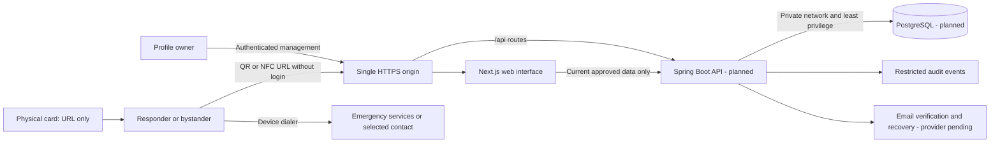
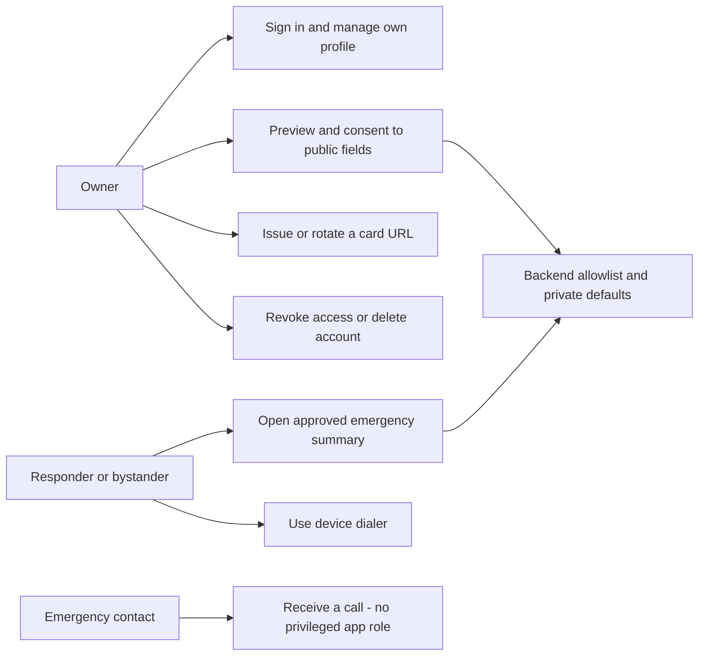

# EMIS architecture

Selected target design, 2 November 2026. This document and the linked decision record define report Section 7. The existing implementation is a static Next.js page. PR #21 is a separate UI correction; the API, database, sessions, public projection and QR/NFC lifecycle remain planned.

## Scope and stakeholders

The patient/card owner manages their own self-reported profile. An emergency responder or bystander opens an intentionally public summary without installing an application or signing in. A trusted emergency contact receives a call but gains no application permissions. The supervisor reviews academic scope and evidence; operators maintain infrastructure without a patient-browsing application role.

Identification and authorization are different: a card URL resolves a shared summary; it does not verify the patient's identity or authenticate the scanner. Owner authentication is required to manage private information. No clinician-specific full-record or break-glass access tier is included in this prototype.

## Context and trust boundaries



TB-1: anyone can read/copy a card. TB-2: the public internet crosses the HTTPS boundary. TB-3: owner sessions and anonymous reads have different authorization rules inside the API. TB-4: the service reaches the private database and restricted event store. TB-5: recovery delivery is external and must not receive health details.

Editable figures: [system context](diagrams/system-context.svg), [use cases](diagrams/use-cases.svg), [logical data model](diagrams/data-model.svg) and [emergency flow](diagrams/emergency-flow.svg).

## Component responsibilities and repository structure

| Component | Target responsibility | Source/evidence today |
|---|---|---|
| Next.js | Public view, owner forms, visibility preview, errors and QR rendering | frontend/src/app/page.tsx static prototype; separate corrected fixture in PR #21 |
| HTTPS reverse proxy | One origin, /api routing, TLS, safe headers, sensitive-path log suppression | Deployment configuration not implemented |
| Spring Security/session layer | Authentication, CSRF, session lifecycle, ownership gates | Backend plan only |
| Profile service | Transactions, validation, visibility projection, deletion | No backend application source |
| Identifier service | Random URL issuance, digest lookup, revoke/rotate | Planned |
| PostgreSQL | Profile integrity, session persistence and identifier constraints | Logical schema documented, no migrations |
| Audit/cleanup jobs | Minimal events, retention, purge and restore safeguards | Planned |

Canonical source files live under docs/; Word companions are readable snapshots. The intended backend packages are security, profile, identifier and audit beneath one application package, with migrations in backend/src/main/resources/db/migration and tests under backend/src/test. These directories are planned; documentation does not create runnable backend stubs.

## Use cases



UC-01: scan QR or tap NFC, open /emergency/{publicId}, retrieve only approved current information, read warnings and update time, optionally open the device dialer. Invalid/revoked/disabled identifiers return neutral unavailable output. No owner login is required for this intentionally public subset.

UC-02: owner authenticates, edits validated data, reviews public preview, selects fields and explicitly publishes. Authentication/ownership and CSRF checks precede any write. A different owner's IDs are rejected. Newly added fields remain private until selected.

UC-03: owner reports a lost/copied card, authenticates recently, revokes or rotates the active identifier and downloads a replacement. Old QR and NFC links both fail on subsequent reads. Existing copied data cannot be recalled.

UC-04: owner requests deletion after recent authentication. Publication, identifiers and sessions are disabled immediately; primary purge, minimal deletion ledger and backup expiry follow ADR-11.

## QR and NFC workflow

```mermaid
sequenceDiagram
    participant O as Owner
    participant API as Spring Boot API
    participant DB as PostgreSQL
    participant R as Responder browser
    O->>API: Authenticated issuance after publication consent
    API->>DB: Store SHA-256 digest of a random 32-byte identifier
    API-->>O: Return /emergency/{publicId} URL once
    Note over O,R: QR and NFC NDEF URI contain the same HTTPS URL only
    R->>API: GET /api/public/profiles/{publicId}
    API->>DB: Check active identifier, account, consent and field visibility
    DB-->>API: Current permitted values
    API-->>R: Allowlisted summary; Cache-Control no-store
    O->>API: Authenticated revoke or rotate
    API->>DB: Revoke previous identifier transactionally
    R->>API: Request old URL again
    API-->>R: Neutral 404 without medical fields
```

QR generation happens in the owner UI from the issued URL; scanning uses the phone camera. NFC is an NDEF URI record read by a compatible phone and opens the same web route; Web NFC permission is not required for a native-reader URL journey. Provisioning and compatibility require physical tests. A printed QR is the fallback when NFC is unsupported; damaged QR can use NFC if it remains readable. No workflow promises that a destroyed card or absent network can retrieve a hosted record.

## Data and privacy design

See [data-model.md](data-model.md) for entities and constraints and [privacy-and-security.md](privacy-and-security.md) for the access matrix, publication consent, sessions, encryption, audit and retention. Same-origin owner sessions are separate from opaque public identifiers. Every public read applies the backend allowlist; no cache or frontend-only privacy flag substitutes for it.

## Failures and residual limits

Without connectivity show unavailable information and emergency-services guidance; do not load a fictional fallback as patient data. If the owner cannot authenticate, private management remains denied while a previously published public URL can still be viewed. Invalid, unknown and revoked links are neutral. Recovery does not identify a patient clinically. Outdated or incorrect self-reported data, copied URLs, prior screenshots and service failure remain risks.

## Decisions, verification and feedback

[decisions.md](decisions.md) records ADR-01–ADR-12. [verification.md](verification.md) provides measurable checks tied to canonical FR/NFR IDs. [feedback-response-matrix.md](feedback-response-matrix.md) maps initial supervisor comments to document revisions and outstanding implementation. The initial feedback is received; approval of this revised baseline and clinical/data field suitability remain pending follow-up.
