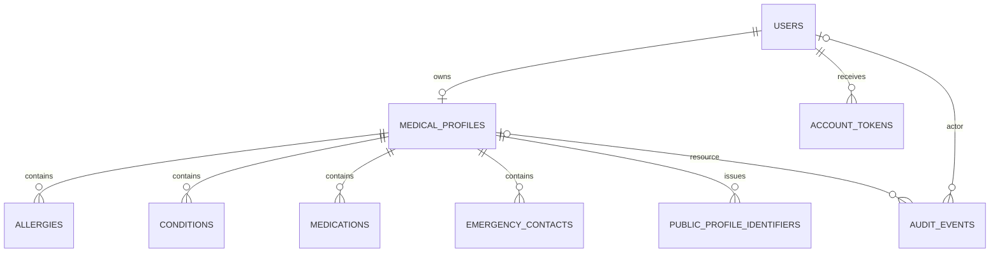

# Data model

Logical target schema, 2 November 2026. No tables or migrations are implemented. UUIDs below are internal keys, not public URL identifiers. The model follows [architecture decisions](decisions.md) and [privacy rules](privacy-and-security.md).

## Entities

| Table | Main fields | Constraints and lifecycle |
|---|---|---|
| users | id UUID PK, email, password_hash, status, created_at | Unique normalized email; status pending/active/disabled; no public account metadata |
| medical_profiles | id UUID PK, user_id FK, display_name nullable, blood_type nullable, display_name_public false, blood_type_public false, publication_enabled false, consent_version nullable, consent_at nullable, updated_at, version | One profile per user; blood type restricted to known ABO/Rh values or null; enabled publication requires consent; optimistic version for lost-update protection |
| allergies | id UUID PK, profile_id FK, label, is_public false | Explicit selected entries; label 1–200 characters; no inference from missing entries |
| conditions | id UUID PK, profile_id FK, label, is_public false | Same entry-level policy as allergies |
| medications | id UUID PK, profile_id FK, label, is_public false | Self-reported labels only; no dosing advice generated |
| emergency_contacts | id UUID PK, profile_id FK, name, relationship nullable, phone_e164, is_public false, sharing_permission_confirmed false | Publish only after owner acknowledgement; phone canonicalized and validated; one entry is one visibility unit |
| public_profile_identifiers | id UUID PK, profile_id FK, token_digest BYTEA, created_at, revoked_at nullable | UNIQUE token_digest; at most one active row per profile via partial unique index where revoked_at IS NULL; digest is 32 bytes; raw token not stored |
| account_tokens | id UUID PK, user_id FK, kind, token_digest, expires_at, consumed_at nullable | Verification/recovery only; independent of public identifiers; single-use, 30-minute expiry |
| audit_events | id UUID PK, occurred_at, event_type, outcome, actor_user_id nullable FK, resource_profile_id nullable FK, correlation_id | No medical values or secrets; FK references SET NULL on deletion; purge events after 30 days |
| deletion_jobs | id UUID PK, account_ref UUID, requested_at, purged_at nullable, retain_until | Restricted operational ledger; account_ref deliberately has no cascading FK; at most 30 days after purge; replay before restored data is served |
| Spring Session JDBC tables | Framework-managed session and session attributes | Separate from profiles; no medical values in session attributes; server expiry and invalidation |

## Relationships

Deletion jobs intentionally outlive primary account deletion and are not linked by a cascading FK. Session tables are framework-managed. Diagram cardinalities describe the logical model, not deployed tables.

## Consistency and validation

Create/update the profile, entry visibility and publication consent in one transaction. Each child row is scoped through the session owner's profile. Validate child IDs against that profile before modifying or deleting them; a UUID alone is not authorization. Request bodies reject unknown fields, ownerId and password/audit fields. Profile update uses a version precondition and returns 409 for stale writes.

Limit each list to 50 entries; name/alias and contact name to 100 characters, relationship to 80, medical label to 200 and international phone to a validated E.164 value. Null, not an empty string, represents unknown blood type. The initial integration uses plain text fields and no file uploads. Frontend escaping and backend validation are both required.

Issuance checks publication consent and at least one selected populated field. Rotation revokes the existing row and inserts the new digest within one transaction. The database unique constraint is the final guard against concurrent issuance. Readers use a statement/transaction snapshot of identifier, publication state and selected fields. A request that starts after a successful revocation/visibility-change response must observe the new state; in-flight reads that began earlier cannot be recalled.

Primary profile deletion cascades to medical/contact/identifier records and account tokens. Session invalidation precedes purge. Audit references are cleared; restricted deletion jobs survive for backup replay and are themselves expired. Preserve deletion jobs independently of a restored database snapshot until the 30-day backup window closes.

## Public response projection

Build a dedicated PublicProfileResponse from active identifier + active user + enabled publication + selected populated fields. Do not serialize ORM entities. The response contains no internal IDs or hidden-field metadata. Optional keys are omitted if not shared; the UI uses neutral missing-information text rather than claiming a medical fact is absent. A lastUpdatedAt value and unverified-data notice accompany a successful summary.
